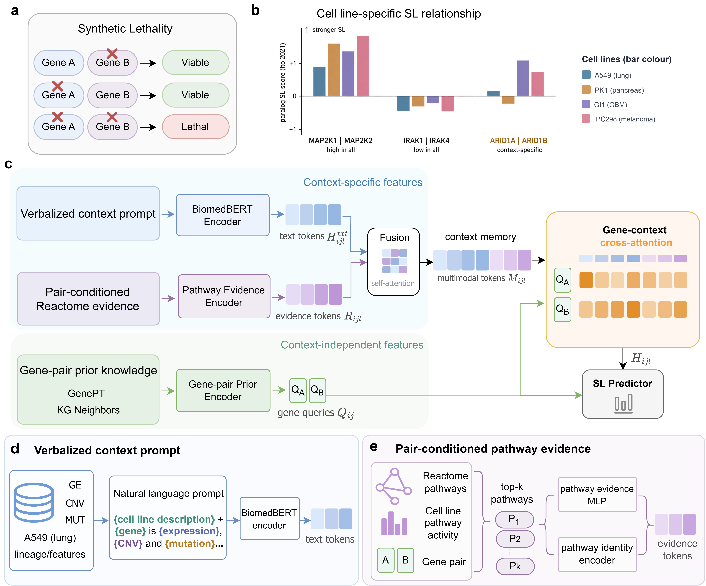

# PromptCASL — cell-line-specific synthetic lethality prediction

Code for the IEEE BIBM 2025 paper *Prompt-Driven Context-Aware Prediction of Cell-Line-Specific
Synthetic Lethality via Biomedical Large Language Models*.

PromptCASL predicts whether a candidate gene pair is synthetically lethal in a given cancer cell
line. The model combines

* a **verbalized molecular profile** — cell-line description followed by the expression,
  copy-number and mutation state of the two genes — encoded by a fine-tuned BiomedBERT,
* **three cell-line omics encoders** (GE / CNV / MU, L1000 landmark overlap, 942 values each),
* **context-free gene priors**: GenePT gene embeddings fused with PrimeKG neighbour embeddings
  through multi-head attention,

which are concatenated into a 6×768 representation and passed to an MLP classifier.




## Repository layout

```
src/
  config.py               path configuration (third-party inputs via environment variables)
  data_loader.py          dataset container + SCL / MCL / MCTL loaders
  preprocess_datasets.py  builds the per-fold .pt datasets (text + GenePT + KG features)
  data_prepare.py         generates the verbalized prompt templates (already shipped)
  model.py                omics encoders, gene aggregator, LLM encoder, predictor
  train_model.py          train / validate / eval loops
  main.py                 SCL / MCL / MCTL entry point
  eval.py                 per-cell evaluation from saved checkpoints
scripts/
  train_conve_primekg.py  trains ConvE on PrimeKG → gene-KG entity embeddings
  build_kg_neighbors.py   builds the per-gene 100-neighbour tables
data/
  folds_assignment/       cross-validation splits (see docs/DATA_DICTIONARY.md)
  text_template_genes/    prompt templates, one JSON per cell line
  multi_omics/            cell-line GE/CNV/MU vectors (942 × 3 per cell line)
docs/
  DATA_DICTIONARY.md      what every data file contains
```

## Environment

```bash
conda env create -f env.yaml
conda activate promptcasl
```

## External data

Third-party resources are not redistributed. Put them under `data/external/` (or point the
matching environment variable somewhere else); `src/config.py` lists all of them.

| Resource | Variable | Expected file |
|---|---|---|
| CCLE expression / copy-number / mutation | `PROMPTCASL_CCLE_DIR` | `GE.csv`, `CNGene.csv`, `MU.csv` |
| BiomedBERT checkpoint | `PROMPTCASL_BIOMEDBERT` | HF snapshot directory |
| GenePT gene embeddings | `PROMPTCASL_GENEPT_PKL` | `GenePT_gene_protein_embedding_model_3_text.pickle` |
| PrimeKG ConvE entity embeddings | `PROMPTCASL_PRIMEKG_EMB` | `conv_primekg_entity_embeddings.npy` |
| PrimeKG gene-neighbour tables | `PROMPTCASL_KG_NEIGHBORS` | `{cell_line}_neighbors.tsv` |
| SLKB labels (only needed to rebuild the splits) | `PROMPTCASL_SLKB_RAW` | `rawSL.csv` |

## Pipeline

All commands are run from the repository root.

**1. PrimeKG resources** (needed once)

```bash
python -m scripts.train_conve_primekg --dim 768 --epochs 10 --device 0
python -m scripts.build_kg_neighbors
```

**2. Per-fold datasets**

```bash
python -m src.preprocess_datasets
# writes data/datasets/cell_line_biomedbert_kg50shared/{cell_line}_F{1..5}.pt
```

**3. Training and evaluation**

```bash
# SCL — one model per cell line, 5-fold CV
python -m src.main --cell_line A549 --llm_lr 1e-5 --omics_encoder 1 --batch_size 24 \
    --num_epochs 50 --early_stop_patience 6 --lr_patience 3 --weight_decay 1e-5 --device 0

# MCL — one model over A549/PK1/IPC298/MEWO
python -m src.main --cell_line mixed --llm_lr 1e-5 --omics_encoder 1 --batch_size 24 \
    --num_epochs 50 --early_stop_patience 6 --lr_patience 3 --weight_decay 1e-5 --device 0

# MCTL — train on the four source lines, evaluate on unseen lines
python -m src.main --cell_line mctl --cell_line_set A549 PK1 IPC298 MEWO \
    --target_cell_lines 22RV1 GI1 HS936T --llm_lr 1e-5 --omics_encoder 1 --device 0
```

Outputs:

* `save/{SCL,MCL,MCTL}/<cell_line>/<timestamp>/` — checkpoints (`model_*_F{k}.pt`), `training.log`,
  `final_results.csv` (one row per fold plus mean/std rows)
* `results/MCL/<timestamp>.csv` — per-cell-line metrics for the MCL model
* `results/MCTL/<timestamp>.csv` — per-target metrics for the MCTL model

## Citation

Ting Lu, Yimiao Feng, Ruoyin Zhang, Yingfan Rui, Jie Zheng. *Prompt-Driven Context-Aware
Prediction of Cell-Line-Specific Synthetic Lethality via Biomedical Large Language Models.*
2025 IEEE International Conference on Bioinformatics and Biomedicine (BIBM), pp. 318-324.
DOI: [10.1109/BIBM66473.2025.11356200](https://doi.org/10.1109/BIBM66473.2025.11356200)

## License

MIT — see `LICENSE`.
