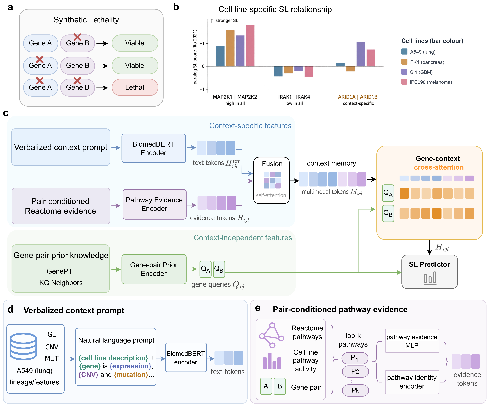

# PromptCASL

Context-aware prediction of cell line-specific synthetic lethality (SL) with biomedical language models and multimodal context modeling.



## Overview

PromptCASL predicts whether a candidate gene pair is synthetically lethal in a given cancer cell line. For each gene pair and cell line it builds a multimodal context memory from:

- a **verbalized molecular profile** (the cell-line description followed by the gene expression, copy-number and mutation state of the two genes) encoded by BiomedBERT, and
- **pair-conditioned Reactome pathway evidence** (one token per top-ranked pathway).

Gene-level priors from GenePT and PrimeKG are used as queries to retrieve this context through cross-attention; the resulting representations are combined for the final SL prediction.

Three evaluation settings are supported:

| Setting | Description |
|---|---|
| **SCL** | single-cell-line learning, 5-fold cross-validation within one cell line |
| **MCL** | multi-cell-line learning (random split, plus a gene-pair leave-out split, GPLO) |
| **MCTL / LOCO** | leave-one-cell-line-out transfer to an unseen cell line |

## Repository layout

```
PromptCASL/
├── src/
│   ├── config.py               path configuration (external data via env vars)
│   ├── data_prepare.py         generate the verbalized prompt templates
│   ├── preprocess_datasets.py  build the per-fold .pt datasets
│   ├── data_loader.py          dataset and SCL/MCL/MCTL/LOCO loaders
│   ├── model.py                model components
│   ├── pair_pathway.py         pair-conditioned pathway-evidence builder
│   ├── pathway_utils.py        Reactome gene sets and pathway activity scores
│   ├── train_model.py          training / validation loops
│   ├── main.py                 SCL / MCL (+GPLO) entry point
│   ├── main_loco.py            MCTL / LOCO entry point
│   └── eval.py                 checkpoint loading and fold evaluation
├── data/
│   ├── build_splits.py         build the cross-validation splits
│   ├── folds_assignment/       split definitions (SCL / MCL / GPLO / LOCO)
│   ├── text_template/          prompt templates
│   └── multi_omics/            Reactome pathway-evidence artifacts
├── scripts/
│   ├── build_reactome_pair_evidence.py  precompute the pathway-evidence artifacts
│   ├── build_kg_neighbors.py            build the PrimeKG neighbor tables
│   ├── train_conve_primekg.py           train ConvE on PrimeKG for the gene-prior embeddings
│   ├── eval_ablation_subsets.py         per-cell-line / per-subset ablation evaluation
│   ├── eval_direction_consistency.py    within-pair direction consistency
│   └── kgslomics/                       KG-SLomics baseline re-implementation
├── ana/                        interpretability helpers and notebooks
└── env.yaml
```

## Environment

A CUDA-enabled GPU is required for training and evaluation.

```bash
conda env create -f env.yaml
conda activate promptcasl
```

## External data

Third-party resources are not redistributed. Their locations are read from environment variables; `src/config.py` lists every variable and its default path under `data/external/`.

| Resource | Variable |
|---|---|
| CCLE expression / copy-number / mutation | `PROMPTCASL_CCLE_DIR` |
| SLKB labels | `PROMPTCASL_SLKB_RAW` |
| GenePT embeddings | `PROMPTCASL_GENEPT_PKL` |
| PrimeKG embeddings / dictionary / triples | `PROMPTCASL_PRIMEKG_EMB`, `PROMPTCASL_PRIMEKG_EMB128`, `PROMPTCASL_PRIMEKG_ENTITY_JSON`, `PROMPTCASL_PRIMEKG_TRIPLES_TSV` |
| PrimeKG neighbor tables | `PROMPTCASL_KG_NEIGHBORS` |
| NCBI gene summaries (v3 prompt) | `PROMPTCASL_NCBI_SUMMARY` |
| Reactome gene sets (MSigDB C2:CP) | `PROMPTCASL_GMT_C2CP` |
| BiomedBERT encoder | `PROMPTCASL_BIOMEDBERT` |
| SLBench 9845-gene universe | `PROMPTCASL_SLBENCH_META` |
| Sanger ProCan proteomics | `PROMPTCASL_SANGER_PROCAN` |

## Pipeline

Run all commands from the repository root.

**0. PrimeKG resources (optional)**

The gene-prior embeddings and neighbor tables are precomputed once:

```bash
python -m scripts.train_conve_primekg --dim 768 --epochs 10 --device 0   # conv_primekg_entity_embeddings.npy
python -m scripts.build_kg_neighbors                                    # data/KG_neighbors/*.tsv
```

**1. Prompt templates**

```bash
python -m src.data_prepare          # writes data/text_template/
```

**2. Pathway-evidence artifacts**

```bash
python -m scripts.build_reactome_pair_evidence --device 0   # writes data/multi_omics/reactome_*
```

**3. Cross-validation splits**

```bash
python -m data.build_splits         # writes data/folds_assignment/splits_v2
```

**4. Datasets**

```bash
python -m src.preprocess_datasets   # writes data/datasets/cell_line_biomedbert_kg50shared
```

**5. Training and evaluation**

```bash
# single cell line (SCL)
python -m src.main --cell_line A549 --omics_mode pair_pathway_evidence --pathway_topk 16 --device 0

# multi-cell-line (MCL), and the gene-pair leave-out split (GPLO)
python -m src.main --cell_line mixed-6cl      --omics_mode pair_pathway_evidence --pathway_topk 16 --device 0
python -m src.main --cell_line mixed-6cl-gplo --omics_mode pair_pathway_evidence --pathway_topk 16 --device 0

# leave-one-cell-line-out transfer (MCTL / LOCO)
python -m src.main_loco --loco_mode np1  --target_cell_line A549 --omics_mode pair_pathway_evidence --device 0
python -m src.main_loco --loco_mode full --target_cell_line A549 --omics_mode pair_pathway_evidence --device 0
```

Training writes checkpoints, logs and metrics under `save/`. Use `python -m src.main --help` and `python -m src.main_loco --help` for the full list of options (learning rates, ablation flags, LoRA, etc.).

## Analysis

Baseline:

```bash
python scripts/kgslomics/build_kg.py
python scripts/kgslomics/build_features.py --protein procan
python scripts/kgslomics/run.py --scenario mcl --split gplo --fold 0
```

Scripts (run after training):

```bash
python -m scripts.eval_ablation_subsets     --device 0 [--model_ids ...]
python -m scripts.eval_direction_consistency
```

The notebooks and analysis helpers in `ana/` read cached attention, prediction and checkpoint artifacts. These are produced by the scripts above (or by the cache generators `ana/gen_pair_attn_cache.py` and `ana/gen_llm_selfattn_cache.py`) and are resolved by `ana/model_version.py` relative to the repository root by default.

## Data availability

CCLE, SLKB, Reactome (MSigDB C2:CP), GenePT and PrimeKG are available from their original public sources. Processed SL labels, prompt templates, Reactome pathway-evidence artifacts and the cross-validation splits used in this study are provided in this repository.

## License

See `LICENSE`.
